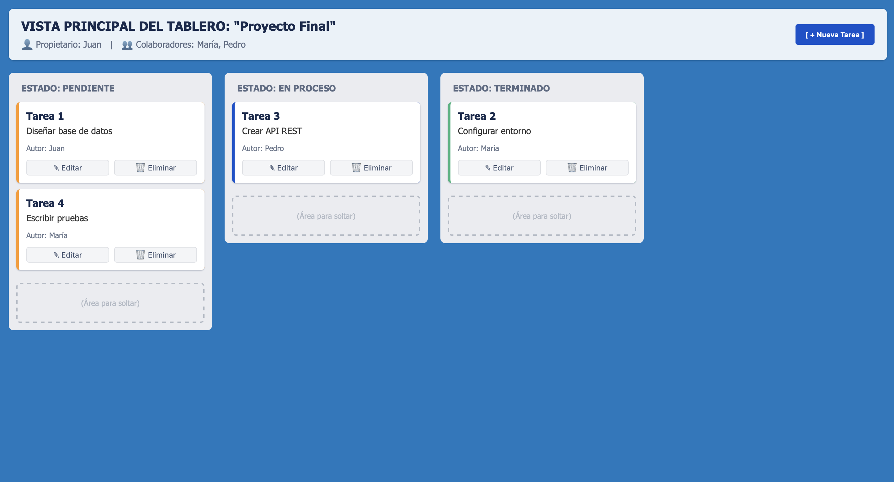
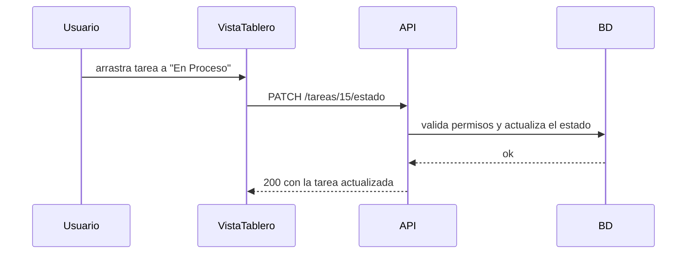
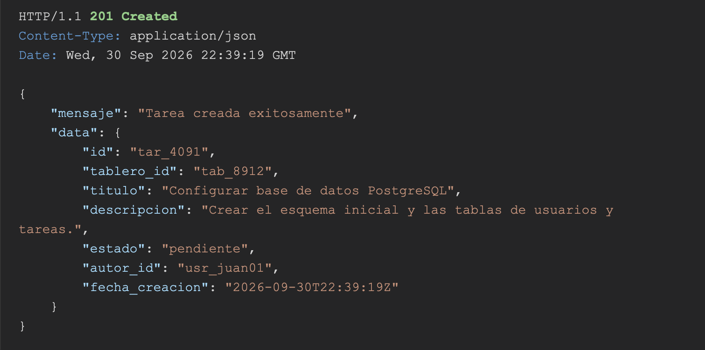
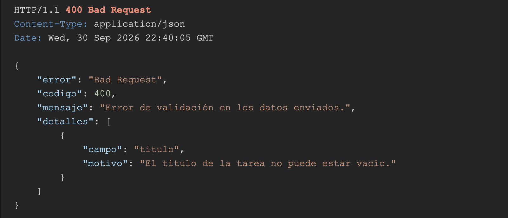

# Hito 1 · Addendum técnico

**Pareja:** Maholy García · Brittany García
**Paralelo:** A

## A. Estructura del proyecto

```text
Notix-Backend/
├── main.go # Entrada raíz: go run . arranca la API.
├── config/config.go # Variables de entorno y validación.
├── database/database.go # PostgreSQL, migraciones y datos de demostración.
├── internal/
│ ├── handlers/ # Handlers HTTP de autenticación y tareas.
│ ├── httpapi/ # Rutas y ensamblado por capas.
│ ├── middleware/ # Validación JWT.
│ ├── models/models.go # Seis structs del negocio y la tabla Cuenta.
│ ├── repository/ # Consultas GORM.
│ └── services/ # Permisos y máquina de estados.
├── docs/ # Ficha, contrato OpenAPI, Bruno y documentación del Hito 2.
├── docker-compose.yml # PostgreSQL en contenedor.
├── .env.example # Valores de desarrollo configurables.
├── go.mod
├── go.sum
└── README.md
```

## B. Configuración y secretos

| Variable    | Para qué sirve                                   | Ejemplo (sin datos reales) |
| ----------- | ------------------------------------------------ | -------------------------- |
| Puerto      | Puerto en el que se ejecuta el servidor HTTP     | 8080                       |
| DB_HOST     | Host del servidor de la base de datos PostgreSQL | localhost                  |
| DB_PORT     | Puerto publicado para PostgreSQL                  | 5434                       |
| DB_USER     | Usuario de la base de datos utilizado por GORM   | notix                      |
| DB_PASSWORD | Contraseña para autenticar con PostgreSQL        | @qlslsl@                   |
| DB_NAME     | Nombre de la base de datos de Notix              | DB_notix                   |

**Archivo de ejemplo:** .env.example

## C. Pruebas

<!-- Cuántas pruebas tienen y qué caso cubre cada una. Después, la captura de la corrida. -->

| Prueba                       | Qué caso cubre |
| ---------------------------- | -------------- |
| **TestValidTransition** | Prueba las cuatro transiciones permitidas y rechaza explícitamente `pendiente → completado`. |
| **TestTaskAPIIntegration** | Con PostgreSQL, cubre 401 sin token, login, acceso de colaborador, creación/listado de tareas, 403 al cambiar estado como colaborador, 200 como propietario y 422 para la transición prohibida. |

La prueba de integración se omite si PostgreSQL no está disponible. Inicie
Docker Compose para ejecutarla; `RUN_DB_INTEGRATION=true` hace que una conexión
fallida se reporte como error en vez de omisión.

La captura `hito1_pruebas.png` corresponde al Hito 1 y no sustituye la captura
de `go test ./...` que se debe tomar para el Hito 2.

## D. Boceto de la pantalla principal

<!-- La pantalla que consume el endpoint de listado. A mano y fotografiada, o en cualquier herramienta.
     Tiene que verse qué campos muestra y dónde aparece el estado. -->



## E. Diagrama de secuencia del caso de uso principal



## F. Capturas de respuestas

<!-- Dos capturas: una petición que sale bien y una que falla la validación. Que se vea el código. -->

**Caso correcto:** 

**Caso con error de validación:** 
